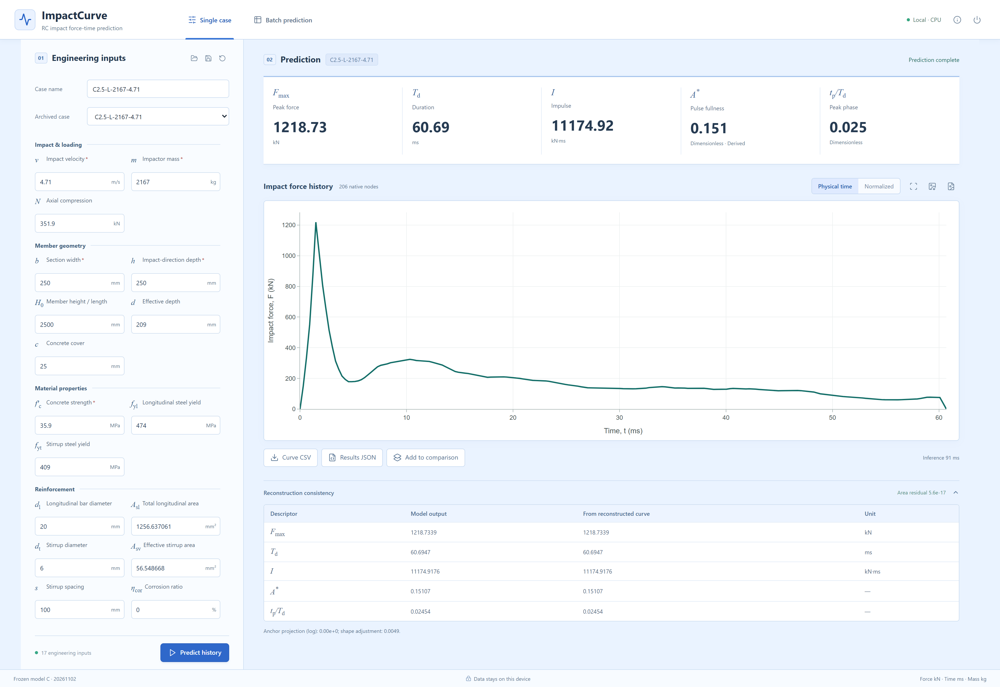

# Impact force–time history dataset for reinforced concrete members

Numerical force histories, engineering metadata, fixed data partitions, trained models,
and reproducible prediction code for transverse impact on reinforced-concrete members.
Version **1.0.0**. Maintainer and dataset curator: **fffaang**.

## Get the force-history dataset

The complete numerical dataset is stored directly in this repository, not behind a request form.

| Content | Location | Description |
|---|---|---|
| All model-ready force ordinates | [Long-format CSV](data/force_histories_long.csv) | 38,403 points across 199 archived records; time in ms, force in kN |
| One CSV per history | [Force histories](data/force_histories) | Native stored knots, without additional smoothing or resampling |
| Native numerical archive | [curves.npz](data/curves.npz) | `curve_id`, `offsets`, `time_ms`, `force_kN` |
| Engineering inputs and extracted anchors | [Record metadata](data/archive_199.csv) | Original frozen numerical values and missing values |
| Ten present-study plotting histories | [Origin worksheet values](data/present10_origin_long.csv) | 10 histories x 500 points; time in **seconds**, force in kN |
| Own plotting source | [FIG3.opju](data/source/FIG3.opju) | Original two-sheet Origin project; distinct from acquisition signals |
| Provenance and rights | [Source mapping](data/source_mapping.csv) | Record-to-publication mapping and original-data attribution |
| Fixed partitions | [Split indices](data/splits) | Three predetermined 158/20/20 train/validation/test partitions |

There are **199 archived records and 198 eligible records**: 169 ordinary-RC experimental
records (including the ten present-study histories), 18 numerical records, 11 special-member
or material records, and one quarantined record, **B3-7-P**. The quarantine is retained in
the archive and excluded from fitting and evaluation. These are not 199 independent physical
experiments. The former four reference histories are included once within the ten and are
not an external validation set. See the [dataset guide](data/README.md) before reuse.

## Predict a force history

Use Python **3.12** and a separate environment. From the repository root:

```shell
python -m venv .venv
# Activate the environment using your operating system's usual command.
python -m pip install -r requirements-inference.txt
python app/app.py
```

The English interface opens on a local loopback address. Prediction runs on CPU; no GPU,
training step, network service, or upload of user inputs is required. The downloadable
[Windows tool](https://github.com/fffaang/impact-force-time-history-prediction/releases/tag/v1.0.0)
requires neither Python nor a GPU. It is unsigned; verify checksums before use.



Command-line prediction and batch export:

```shell
python app/predict.py --input examples/complete_case.json --output output/single
python app/predict.py --batch examples/batch_template.csv --output output/batch
```

The complete example is an archived training case, not an independent validation. Unknown
optional inputs remain missing and use the stored training-fitted imputer; do not invent zeros.
See [input definitions and prediction instructions](docs/PREDICTION.md).

## What the model predicts

Seventeen pre-test engineering inputs and their deterministic derived features feed
target-specific regression ensembles. The production model independently predicts peak force
`Fmax`, active duration `Td`, impulse `I`, and normalized peak phase `tp_ratio`.
It derives `Astar = I/(Fmax*Td)` after the documented consistency projection.
Peak-aligned **PCA8 + ExtraTrees** reconstructs the normalized shape; the final piecewise-linear
history retains explicit peak knots, nonnegative force, and area adjustment. The deployed
prediction averages the three stored model seeds 20260519, 20260520, and 20260521.

Primary partition **20261102**, final model C:

| Metric | Validation (20) | Test (20) |
|---|---:|---:|
| Peak force R² | 0.708100 | 0.923739 |
| Duration R² | 0.875170 | 0.814012 |
| Impulse R² | 0.888084 | 0.983894 |
| Derived normalized area R² | -0.524023 | 0.218431 |
| Peak-phase R² | 0.801862 | 0.819957 |
| Median physical-time curve R² | 0.420561 | 0.515544 |
| Histories with negative curve R² | 4 | 6 |

Complete results for **all three partitions and A/B/C arms** are in [results](results/README.md).
A and B refit the historical architecture on 131 and 158 records; C uses 158 records.
They share each partition's holdouts. The archive has been repeatedly examined: these results
are archive-internal reevaluations, not blind tests or unseen-publication generalization.
Nonnegative force and numerical consistency do not imply accurate prediction for every case.

## Verify and reproduce

```shell
python scripts/verify_dataset.py
python -m pip install -r requirements-replay.txt
python scripts/replay_predictions.py --split all --output output/replay
python -m pip install -r requirements-tools.txt
python scripts/export_workbooks.py --output output/workbooks
python scripts/verify_checksums.py
```

Replay uses saved models without fitting and checks original per-case predictions and curves.
The main repository contains all three final C models. Large A/B models, independent refits,
and the portable Windows application are [Release assets](https://github.com/fffaang/impact-force-time-history-prediction/releases/tag/v1.0.0).
Original training code, selection rules, source-block bootstrap, and scientific tests are
included. The [reproduction guide](docs/REPRODUCIBILITY.md) describes the separate CUDA
training environment and fresh-workspace entry point; search caches are intentionally omitted.

## Organization

| Directory | Purpose |
|---|---|
| `data` | Force histories, metadata, source evidence, dictionary, and frozen indices |
| `models` | Three final C models, identical to the archived model bytes |
| `src`, `config`, `legacy`, `tests` | Scientific training, selection, reconstruction, evaluation, and tests |
| `scripts` | Dataset checks, result replay, workbook export, explanation, and fresh-workspace reproduction |
| `results` | Per-case predictions, comparisons, rankings, bootstrap, SHAP, and numerical checks |
| `figure_data` | Figure source values in Excel and per-sheet CSV; manuscript-era filenames retained |
| `app`, `examples`, `docs` | Local prediction interface, CLI, examples, and documentation |
| `provenance` | Original computational seals, byte-identity records, and release checks |

## Citation and license

Use [CITATION.cff](CITATION.cff):

> fffaang (2026). *Impact force–time history dataset for reinforced concrete members*,
> version 1.0.0. https://github.com/fffaang/impact-force-time-history-prediction

Original software and model weights are under [MIT](LICENSE). Original present-study data
and original curation are under [CC BY 4.0](DATA_LICENSE.md). Reused third-party data
retain their original rights and source attribution; this is not a blanket relicense of the
underlying publications. No article PDFs are distributed. See [third-party notices](THIRD_PARTY_NOTICES.md).

Source conflicts, incomplete contact/support metadata, repeated-damage cases, heterogeneous
concrete-strength definitions, and incomplete pointwise digitization verification remain
documented. This is a research tool, not a design-code check or a substitute for structural assessment.
